# 🧾 Receipt2Vec - 영수증 OCR + RAG 가계부 챗봇

> 영수증 사진 한 장으로 지출을 기록하고, 대화로 묻고 답하는 AI 가계부

<br/>

## 🛠️ Tech Stack

### Backend


-000000?style=for-the-badge&logo=jsonwebtokens&logoColor=white)

### Frontend


### Database & Search


### Infrastructure & DevOps


### Monitoring


<br/>

## 📌 프로젝트 개요

**Receipt2Vec**은 영수증·결제앱 캡처를 OCR로 인식해 거래로 저장하고, 저장된 거래를 근거로 **"이번 달 카페에 얼마 썼어?"** 같은 자연어 질문에 답하는 RAG 기반 가계부 챗봇입니다.

LLM이 숫자를 지어내지 않도록 **질문 해석은 LLM, 금액·건수 계산은 코드(OpenSearch 집계)** 가 맡도록 역할을 나눴습니다. 답변 아래에는 항상 근거 거래와 집계값이 함께 표시됩니다.

### 핵심 기능
- 📸 **영수증 OCR 등록** - PaddleOCR(PP-OCRv5) 인식 → 규칙 파서 → 필요 시 Gemini 추출 + 원문 대조 검증 → 사용자 확인 후 저장
- 💬 **가계부 챗봇 (RAG)** - 기간·가맹점·품목·업종·지역 조건을 해석해 합계/건수/평균/최대/순위/비교를 SSE로 스트리밍 답변
- 🔎 **하이브리드 검색** - Nori 형태소 + BM25 + kNN 벡터(E5) + Cross-encoder 리랭킹, 0건이면 조건 완화 → 의미 검색으로 단계적 확장
- 🔐 **소셜 로그인 (OAuth2)** - Google·Naver·Kakao, RS256 JWT + JWKS, Refresh Token 회전·재사용 탐지
- 🛡️ **API Gateway** - Nginx 단일 진입점에서 HTTPS 종료, 라우팅, 로드밸런싱, `auth_request` 토큰 검사, Rate limit
- 📱 **모바일 웹 최적화** - 반응형 레이아웃, 카메라 바로 촬영, 키보드/안전 영역 대응, PWA
- 🚀 **CI/CD & 모니터링** - Jenkins → Docker Hub → 운영 서버 자동 배포, Grafana 대시보드 + Slack 알림

<br/>

## 🎬 시연 영상

### 🤖 AI 챗봇 질의
> 순위 집계(top 3) → **이전 대화 맥락 이어받기**("그 중에 제일 비싼 건?") → 요일별 패턴 분석 → **영수증 품목 단위 검색**(아메리카노 → 커피 비중 4.4%) → 근거 거래 펼치기


| 질문 | AI 가 한 일 |
|---|---|
| 가장 많이 쓴 가게 top 3 알려줘 | 질의 의도(순위·가맹점 단위) 파악 → 집계 후 막대 차트 |
| 그 중에 제일 비싼 건? | 직전 답변의 top 3 가맹점으로 범위를 좁혀 재질의 |
| 무슨 요일에 돈을 제일 많이 써? | 요일별 그룹 집계, 금액·건수는 코드로 계산 |
| 이번 달 지출 중에 커피 비중이 얼마나 돼? | "커피" → 아메리카노·라떼로 확장해 영수증 품목 검색, 전체 대비 비중 계산 |

### 🧾 영수증 등록 흐름
> 추천 질문 → 업종별 지출 → 가맹점 순위 → 근거 거래 펼치기 → 영수증 OCR 인식


### 📱 Mobile
&nbsp;&nbsp;

🎥 고화질 영상 : AI 챗봇 [Desktop](docs/videos/demo-ai-desktop.mp4) · [Mobile](docs/videos/demo-ai-mobile.mp4) / 영수증 등록 [Desktop](docs/videos/demo-desktop.mp4) · [Mobile](docs/videos/demo-mobile.mp4)

<br/>

## 🖼️ 스크린샷

### 메인 화면
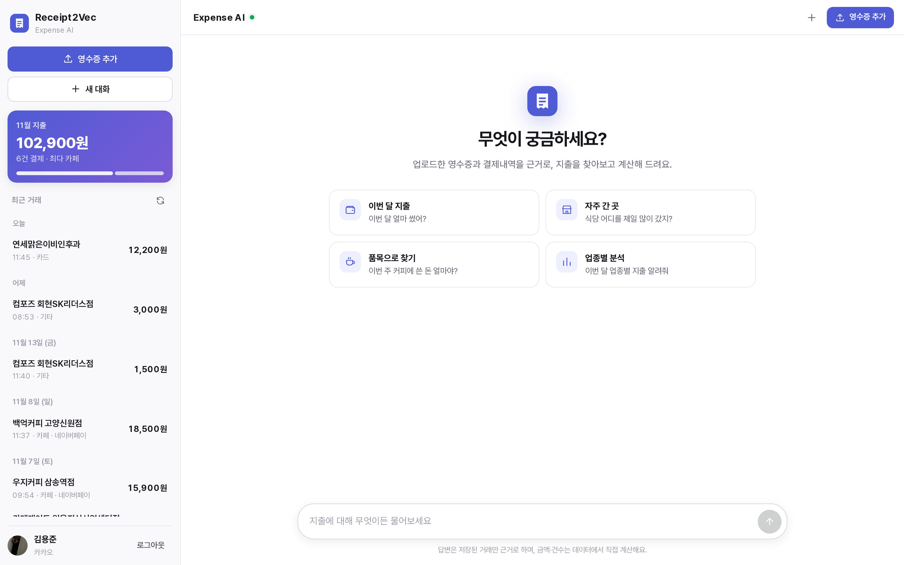

### 가계부 챗봇
| 이번 달 지출 | 업종별 지출 |
|:---:|:---:|
| 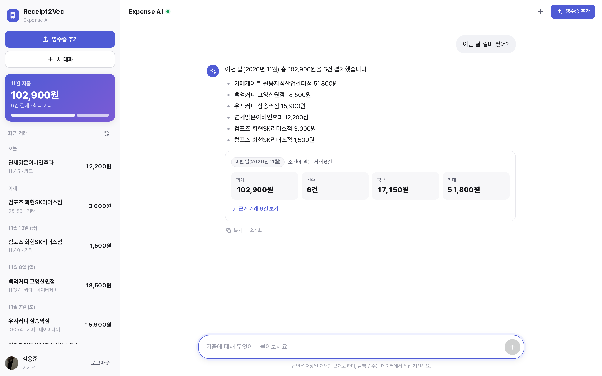 | 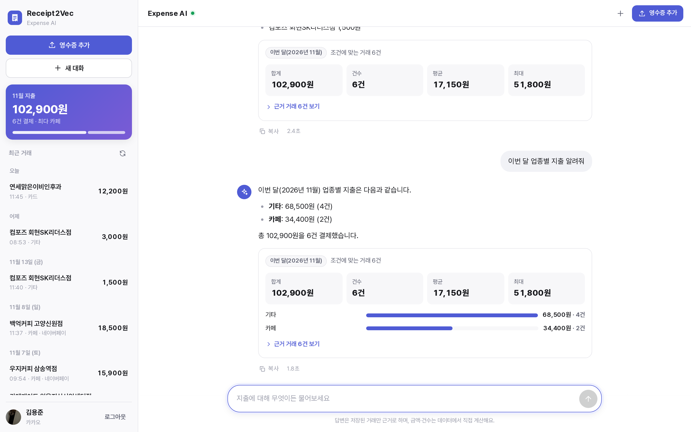 |

| 가맹점 순위 · 근거 거래 | 소셜 로그인 |
|:---:|:---:|
| 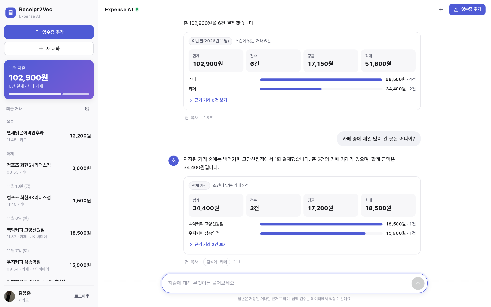 | 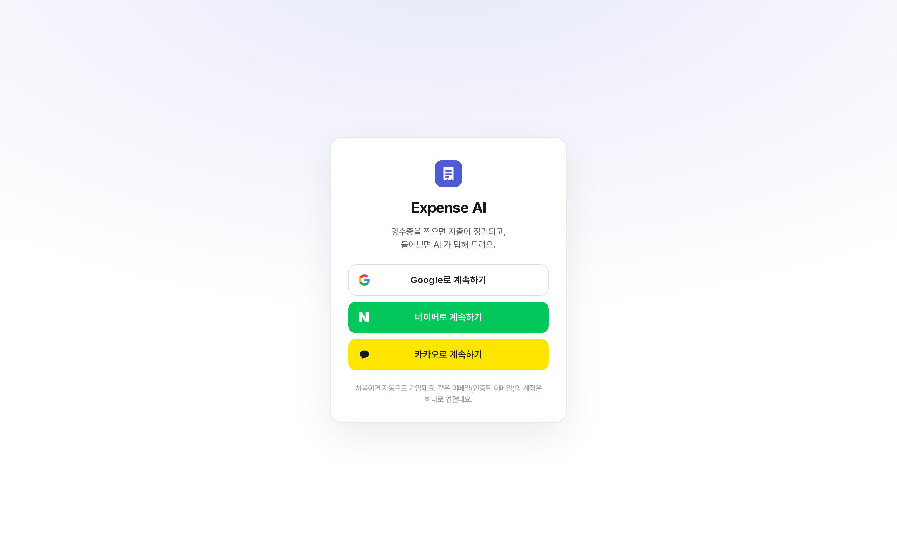 |

### 영수증 OCR 등록
| 사진 선택 | 인식 중 | 인식 결과 확인 |
|:---:|:---:|:---:|
| 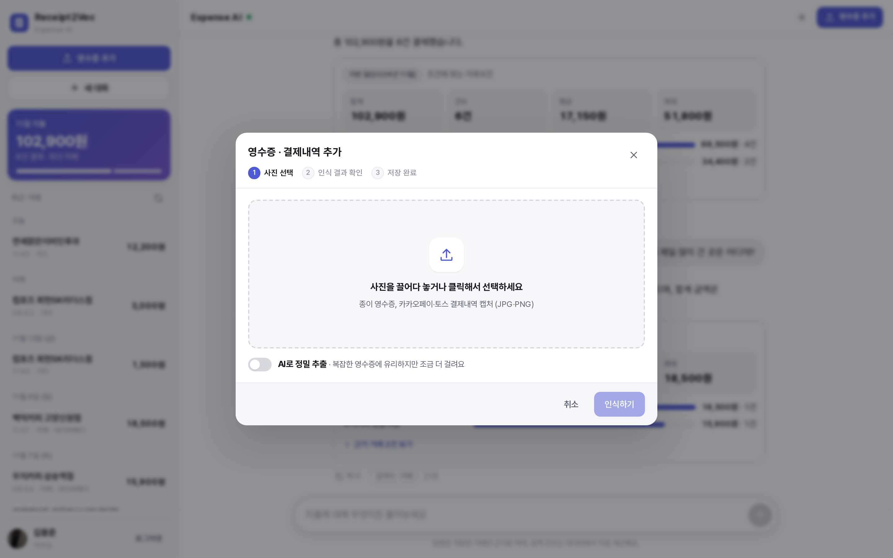 | 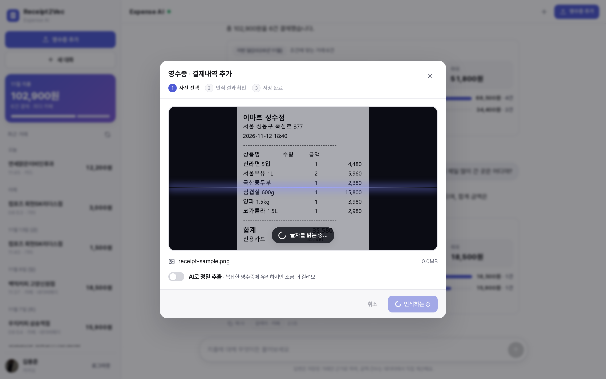 | 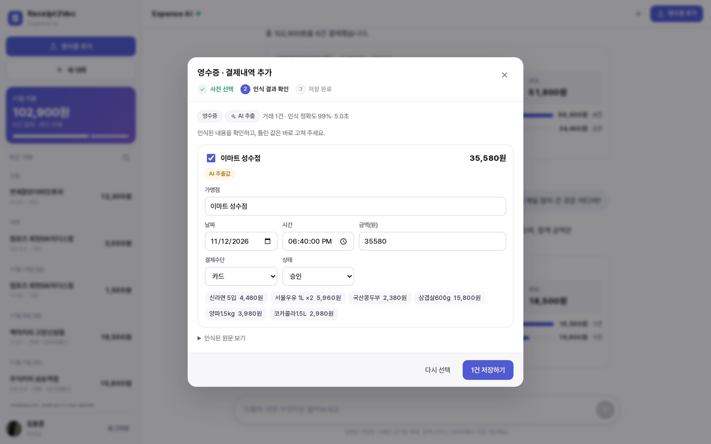 |

### 모바일 웹
| 로그인 | 홈 | 챗봇 답변 | 거래 내역 |
|:---:|:---:|:---:|:---:|
| 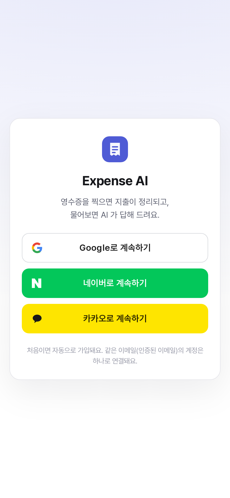 | 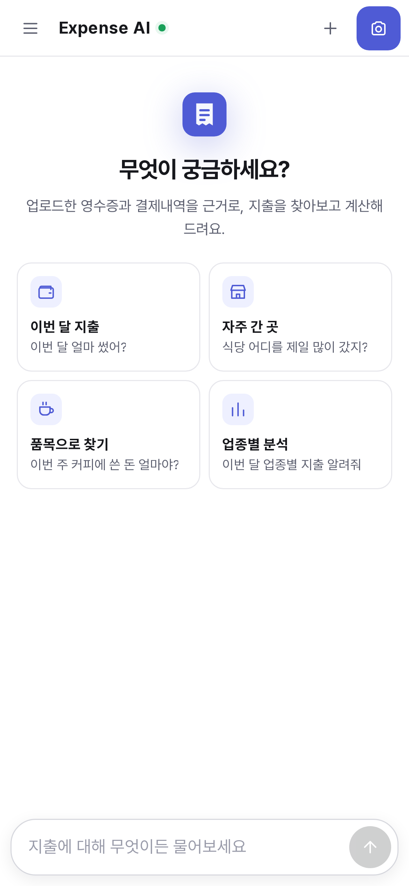 | 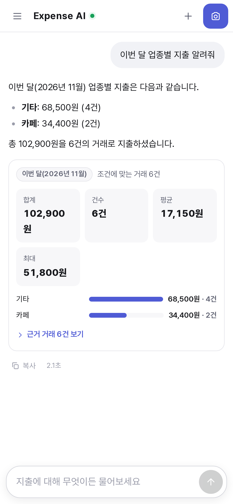 | 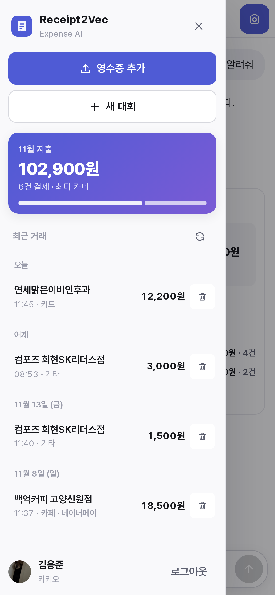 |

<br/>

## 🏗️ 시스템 아키텍처

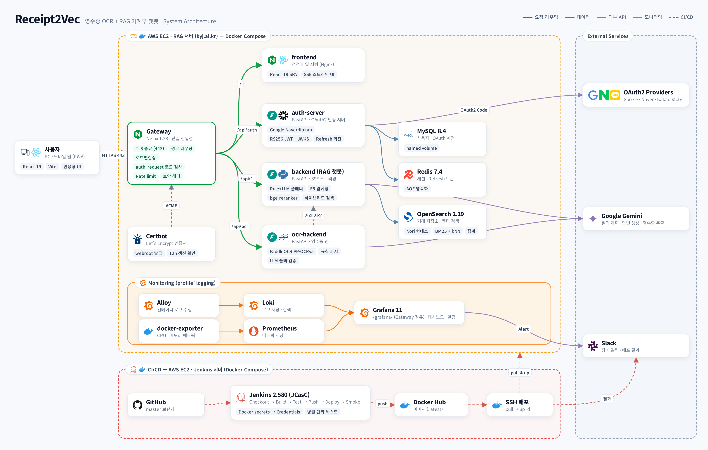

> 다이어그램 원본 : [docs/architecture/architecture.html](docs/architecture/architecture.html)

### 주요 구성 요소

| 구분 | 컨테이너 | 역할 |
|------|----------|------|
| **Gateway** | `gateway` (Nginx 1.28) | 유일한 외부 진입점(80/443). TLS 종료, 경로 라우팅, upstream 로드밸런싱·재시도, `auth_request` 토큰 검사, Rate limit, 보안 헤더 |
| **인증서** | `certbot` | Let's Encrypt 인증서 webroot 발급, 12시간마다 갱신 확인 → Gateway가 무중단 reload |
| **Frontend** | `frontend` (Nginx) | React 19 + Vite 빌드 정적 파일 서빙 |
| **인증 서버** | `auth-server` (FastAPI) | OAuth2(Google·Naver·Kakao) 로그인, RS256 JWT 발급, JWKS 공개, 토큰 검증(`/api/auth/verify`) |
| **RAG 챗봇** | `backend` (FastAPI) | 질의 계획(규칙+LLM) → 거래 조회·집계 → 스트리밍 답변, 거래 저장/조회 API |
| **OCR** | `ocr-backend` (FastAPI) | PaddleOCR 인식, 영수증/결제앱 파싱, LLM 폴백, 확인된 거래를 `backend`에 저장 |
| **검색 저장소** | `opensearch` (2.19 + Nori) | 거래 문서 + 벡터 저장, 하이브리드 검색, 집계 |
| **사용자 DB** | `mysql` (8.4) | 사용자·소셜 계정·로그인 이력 |
| **세션 저장소** | `redis` (7.4, AOF) | 로그인 세션, Refresh Token, OAuth state |
| **모니터링** | `alloy` · `loki` · `docker-exporter` · `prometheus` · `grafana` | 컨테이너 로그·메트릭 수집, 대시보드(`/grafana/`), 장애 Slack 알림 |

<br/>

## 🔄 비즈니스 로직

### 영수증 등록 플로우
```
1. 영수증·결제앱 캡처 업로드 (모바일은 카메라 바로 촬영)
   ↓
2. PaddleOCR (PP-OCRv5) 줄 단위 텍스트 인식
   ↓
3. 문서 유형 판별 (영수증 / 결제앱) → 규칙 파서 → 정규화 → 품질 평가
   ↓
4. 품질이 낮으면 Gemini 추출 → 원문 대조 검증 → 더 나은 결과 채택
   ↓
5. 사용자가 가맹점·날짜·금액·품목 확인/수정 (needsReview 표시)
   ↓
6. backend 저장 → 업종 분류·임베딩 → OpenSearch 색인
```

### 챗봇 질의 플로우
```
1. 질문 입력 ("지난달이랑 이번 달 카페 지출 비교해줘")
   ↓
2. 사용자 어휘(가맹점·업종) 조회 → 플래너가 QueryPlan 생성
   (규칙 해석 + LLM 보강, LLM 결과는 sanitize 로 검증)
   ↓
3. 코드가 날짜 범위 계산 · userId 강제 → TransactionQuery
   ↓
4. OpenSearch 조회 : 정확 매칭 → 조건 완화(RELAXED) → 의미 검색(SEMANTIC)
   ↓
5. 합계·건수·평균·비율·비교값은 코드로 계산 (LLM 계산 금지)
   ↓
6. SSE 스트리밍 : status → plan → result → token... → done
```

### 인증 플로우
```
1. /oauth2/authorization/{provider} → 제공자 로그인 (state·PKCE 는 Redis)
   ↓
2. /login/oauth2/code/{provider} 콜백 → 사용자 생성/연결 (같은 인증 이메일은 하나로)
   ↓
3. Refresh Token → HttpOnly·Secure 쿠키 (path=/api/auth)
   Access Token  → 메모리에만 보관 (XSS 탈취 방지)
   ↓
4. 모든 API 요청 → Gateway auth_request → auth-server 가 서명·만료·세션 검증
   ↓
5. 토큰 갱신 시 Refresh Token 회전, 이미 쓴 토큰 재사용 감지 → 세션 전체 종료
```

### 배포 플로우 (CI/CD)
```
1. master 브랜치 push
   ↓
2. Jenkins (별도 EC2, JCasC) : Checkout → 이미지 빌드 → 서비스별 단위 테스트(병렬)
   ↓
3. Docker Hub push (:커밋해시, :latest)
   ↓
4. 운영 서버 SSH → docker compose pull → up -d (실패 시 로그 출력)
   ↓
5. 외부 Smoke Test (HTTPS·로그인 제공자·미인증 401) → Slack 결과 알림
```

<br/>

## 💡 기술적 고민과 해결

| 문제 | 해결 |
|------|------|
| LLM이 금액·건수를 틀리게 말함 | 질문 해석만 LLM, **숫자는 OpenSearch 집계 + 코드 계산**. 답변 프롬프트에 계산된 값만 전달 |
| "스벅", "편의점"처럼 표현이 제각각 | 브랜드 별칭·업종 사전 + 사용자 어휘 기반 해석, 0건이면 조건 완화 → 의미 검색으로 단계적 확장 |
| LLM 플래너가 잘못된 필터를 만듦 | `sanitize_llm_plan` 으로 사용자 어휘·스키마와 대조해 검증, 규칙 해석과 병합 |
| 챗봇 품질을 감으로 판단 | 질문 유형별 **평가셋 141문항** 자동 채점 (`rag_backend/tests/eval/chat_eval.py`) → 141/141 통과 |
| OCR 오인식 | 규칙 파서 품질 평가 → 필요할 때만 Gemini 호출 + **원문 대조 검증**, 최종 확인은 사용자 |
| 서비스마다 인증 로직 중복 | Gateway `auth_request` 로 일괄 검사 + 각 서비스는 JWKS 로 서명 재검증 (이중 방어) |
| Refresh Token 탈취 위험 | HttpOnly 쿠키 + 회전 + 재사용 감지 (동시 요청 대비 15초 유예) |
| 무중단 HTTPS 전환 | 인증서 발급 전에는 HTTP로 서비스, 인증서 생성을 감지하면 Nginx reload 로 HTTPS 자동 전환 |
| 장애를 늦게 인지 | Loki 로그·Prometheus 메트릭 기반 Grafana 알림 → Slack (에러 로그, API 5xx, 컨테이너 중지, 헬스체크 실패, 메모리 부족) |

<br/>

## 💾 데이터 모델링

### MySQL (auth-server)

| 테이블 | 설명 | 주요 필드 |
|--------|------|-----------|
| **users** | 사용자 | user_uid(JWT sub), email, name, role, status |
| **user_social_accounts** | 소셜 계정 연결 | provider, provider_user_id, email_verified |
| **oauth_providers** | 제공자 설정 | client_id, redirect_uri, scopes, enabled |
| **login_history** | 로그인 이력 | provider, success, failure_reason, ip, request_id |

- **users ↔ user_social_accounts** (1:N) - 한 사용자에 여러 소셜 계정 연결 (같은 인증 이메일이면 자동 연결)

### Redis (auth-server)
- 세션(`sid`) · Refresh Token 해시 · OAuth `state`/PKCE verifier · 로그아웃된 Access Token 무효화

### OpenSearch (backend)

| 필드 | 설명 |
|------|------|
| userId | 사용자 (모든 조회에 강제 필터) |
| date / time | 거래 일시 |
| merchant (name, category, address) | 가맹점 · 업종 · 주소 (Nori + Edge-NGram) |
| amount / status / method | 금액 · 승인/취소 · 결제수단 |
| items | 품목 (이름, 수량, 금액) |
| embedding | E5 벡터 (kNN 의미 검색) |

<br/>

## 📂 프로젝트 구조

```
Receipt2Vec/
├── frontend/                 # React 19 + Vite (반응형 · PWA)
│   └── src/
│       ├── components/       # ChatPanel, UploadDialog, Sidebar, ResultView ...
│       ├── auth.js           # Access Token 메모리 보관 · 자동 갱신
│       └── viewport.js       # 모바일 키보드 · 화면 높이 대응
│
├── rag_backend/              # 가계부 챗봇 · 거래 저장소 (FastAPI)
│   └── app/services/
│       ├── chat/             # planner · period · answerer · service (SSE)
│       ├── transactions/     # 거래 저장 · 조회 · 집계 · 업종 분류
│       ├── opensearch/       # 임베딩(E5) · 인덱스 · 하이브리드 검색
│       └── rerank/           # Cross-encoder (bge-reranker-v2-m3)
│
├── ocr_backend/              # 영수증 OCR (FastAPI)
│   └── app/services/
│       ├── ocr/              # PaddleOCR
│       ├── parser/           # 영수증 · 결제앱 규칙 파서
│       ├── llm/              # Gemini 추출 · 원문 대조 검증
│       └── pipeline.py       # 인식 → 파싱 → 품질 평가 → 폴백
│
├── auth_server/              # OAuth2 인증 서버 (FastAPI)
│   └── app/                  # providers · tokens · users · routes · cli
│
├── docker/
│   ├── gateway/              # Nginx 게이트웨이 (라우팅 · auth_request · HTTPS)
│   ├── opensearch/           # OpenSearch + Nori
│   └── logging/              # Alloy · Loki · Prometheus · Grafana (대시보드 · 알림)
│
├── dev-ops/                  # CI/CD (별도 Compose)
│   ├── Jenkinsfile
│   ├── casc/                 # Jenkins Configuration as Code
│   ├── deploy/               # 운영 오버라이드 compose · prod.env
│   └── scripts/              # 배포 · 시크릿 · 부트스트랩 · Smoke Test
│
└── docker-compose.yml        # 전체 서비스
```

<br/>

## 🚀 주요 API 명세

> `/api/auth/*`, OAuth 경로, 헬스체크를 제외한 모든 API 는 Gateway 에서 Bearer 토큰을 검사합니다.

### 인증
| Method | Endpoint | 설명 |
|--------|----------|------|
| GET | `/api/auth/providers` | 사용 가능한 로그인 제공자 |
| GET | `/oauth2/authorization/{provider}` | 소셜 로그인 시작 (google / naver / kakao) |
| GET | `/login/oauth2/code/{provider}` | OAuth2 콜백 |
| POST | `/api/auth/token/refresh` | Access Token 재발급 (Refresh 회전) |
| POST | `/api/auth/logout` · `/api/auth/logout-all` | 로그아웃 · 모든 기기 로그아웃 |
| GET | `/api/auth/me` | 내 정보 |
| GET | `/.well-known/jwks.json` | 공개키 (JWKS) |

### 챗봇 · 거래
| Method | Endpoint | 설명 |
|--------|----------|------|
| POST | `/api/chat/stream` | 가계부 챗봇 (SSE 스트리밍) |
| GET | `/api/transactions` | 거래 목록 |
| POST | `/api/transactions` | 거래 저장 |
| DELETE | `/api/transactions/{id}` | 거래 삭제 |
| POST | `/api/transactions/query` | 구조화 조회 · 집계 |
| GET | `/api/transactions/vocabulary` | 사용자 어휘 (가맹점 · 업종) |

### OCR
| Method | Endpoint | 설명 |
|--------|----------|------|
| POST | `/api/ocr/recognize` | 사진 인식 → 거래 후보 |
| POST | `/api/ocr/parse` | 텍스트 파싱 |
| POST | `/api/ocr/confirm` | 사용자 확인 결과 검증 |
| POST | `/api/ocr/transactions` | 확인된 거래 저장 |

<br/>

## 🎨 사용자 경험 (UX)

### 대화형 지출 조회
- **추천 질문 카드**로 바로 시작, 답변은 **글자 단위 스트리밍**
- 답변 아래 **집계 카드**(합계·건수·평균·최대)와 **근거 거래** 펼쳐보기 → 숫자를 바로 검증
- 업종·가맹점별 **막대 그래프**, 기간 칩으로 조회 범위 표시

### 영수증 등록
- 3단계 진행 표시 (사진 선택 → 인식 결과 확인 → 저장 완료)
- 스캔 애니메이션, **AI 추출값 배지**, 인식 정확도 표시, 원문 보기

### 모바일 웹
- 반응형 레이아웃 + 슬라이드 사이드바
- 카메라 바로 촬영, 키보드 열림/안전 영역(노치) 대응, 16px 입력으로 iOS 확대 방지
- PWA 매니페스트 (홈 화면 추가)

<br/>

## 🔧 로컬 개발 환경 설정

### Prerequisites
- Docker Desktop (Compose v2.24+)
- Gemini API Key, OAuth 클라이언트 (Google · Naver · Kakao)

### 실행
```bash
# 1. 환경 변수 (모두 git 제외)
cp .env.example .env                      # MySQL·Redis 비밀번호, Slack Webhook
# rag_backend/.env, ocr_backend/.env      # GEMINI_API_KEY
# auth_server/.env                        # OAuth 클라이언트 ID/Secret

# 2. 전체 실행
docker compose up -d --build

# 3. 모니터링까지 함께 실행
docker compose --profile logging up -d
```

| 주소 | 설명 |
|------|------|
| http://localhost:3000 | 서비스 (Gateway) |
| http://localhost:3030 | Grafana |
| http://localhost:5601 | OpenSearch Dashboards |

### 운영 배포
- `dev-ops/` 의 Jenkins Compose 를 별도 서버에 띄우고 `master` 에 push 하면 자동 배포됩니다. 자세한 내용은 [dev-ops/README.md](dev-ops/README.md) 를 참고하세요.
